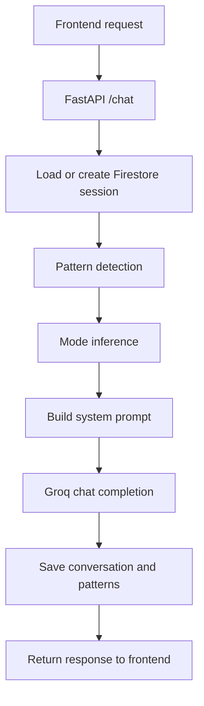

# Mitra — Backend

The FastAPI service for **Mitra**, an adaptive conversational companion. It analyses message patterns, selects a response style, generates replies with the Groq API, and stores conversation sessions and feedback in Firebase Firestore.

<div align="center">

[](https://fastapi.tiangolo.com/)
[](https://www.python.org/)
[](https://firebase.google.com/)
[](https://groq.com/)

</div>

## Overview

Mitra aims to adapt its conversational style to the user's messages instead of responding in one fixed tone.

It currently supports three response modes:

- **Friend** — warm, conversational responses.
- **Guide** — structured, actionable guidance.
- **Therapist** — reflective and empathetic response style.

These are conversational styles only. Mitra is not a licensed therapist, medical service or substitute for professional care.

## How It Works

1. The API receives a message, optional session ID and requested mode.
2. The pattern engine analyses the message using rule-based regular expressions by default.
3. The mode inference logic selects Friend, Guide or Therapist when mode is set to `auto`.
4. A system prompt is built using the selected mode and accumulated pattern profile.
5. The Groq API generates a response.
6. The session history, pattern counters, mode history and message record are stored in Firestore.
7. The API returns the reply, selected mode, updated patterns and message ID.



## Tech Stack

| Area | Technology |
|---|---|
| API framework | FastAPI |
| Language | Python |
| LLM provider | Groq API |
| Database | Firebase Firestore |
| Firebase integration | Firebase Admin SDK |
| Request validation | Pydantic |
| Local configuration | python-dotenv |
| Deployment configuration | Render |

## Project Structure

```text
mitra-backend/
├── main.py              # FastAPI app and API endpoints
├── firebase_config.py   # Firebase Admin and Firestore setup
├── pattern_engine.py    # Pattern detection, mode inference and prompts
├── requirements.txt     # Python dependencies
├── render.yaml          # Render service configuration
├── runtime.txt          # Python runtime version
├── .env.example         # Environment variable template
└── .gitignore
```

## Getting Started

### Prerequisites

- Python 3.12
- A Firebase project with Firestore enabled
- A Groq API key

### 1. Clone the repository

```bash
git clone https://github.com/ManojKumarBhagavatula/mitra-backend.git
cd mitra-backend
```

### 2. Create and activate a virtual environment

**Windows (PowerShell):**

```powershell
python -m venv venv
.\venv\Scripts\Activate.ps1
```

**macOS / Linux:**

```bash
python3 -m venv venv
source venv/bin/activate
```

### 3. Install dependencies

```bash
pip install -r requirements.txt
```

### 4. Configure environment variables

Copy the example file:

```bash
cp .env.example .env
```

On Windows PowerShell, you can use:

```powershell
Copy-Item .env.example .env
```

Set the values in `.env`:

```env
GROQ_API_KEY=your-groq-api-key
FIREBASE_CREDENTIALS_PATH=serviceAccountKey.json
```

The application also accepts an optional `GROQ_MODEL` variable. If it is not set, the code uses `openai/gpt-oss-20b`.

### 5. Configure Firebase credentials

1. Open the [Firebase Console](https://console.firebase.google.com/).
2. Select your project and enable **Cloud Firestore**.
3. Open Project Settings → Service Accounts.
4. Generate a private key for the Firebase Admin SDK.
5. Save the downloaded JSON file in the backend project directory as `serviceAccountKey.json`.

The backend reads this file through `FIREBASE_CREDENTIALS_PATH`. For deployment, it can instead read the full service-account JSON from `FIREBASE_CREDENTIALS_JSON`.

**Never commit** `.env`, `serviceAccountKey.json`, service-account JSON, or private API keys to GitHub.

### 6. Run the API

```bash
uvicorn main:app --reload
```

The API is available at:

- Base URL: [http://localhost:8000](http://localhost:8000)
- Interactive Swagger docs: [http://localhost:8000/docs](http://localhost:8000/docs)
- Health check: [http://localhost:8000/health](http://localhost:8000/health)

## API Reference

### `POST /chat`

Send a message and receive an adaptive response.

**Request body**

```json
{
  "session_id": null,
  "message": "I've been feeling stressed about work lately.",
  "mode": "auto"
}
```

- `session_id`: optional session identifier. Send the returned ID in subsequent requests to continue that session.
- `message`: message text.
- `mode`: `auto`, `friend`, `guide` or `therapist`.

**Response shape**

```json
{
  "session_id": "session-id",
  "reply": "Generated response text",
  "mode_used": "friend",
  "patterns": {
    "emotional": 1,
    "venting": 0,
    "advice": 0,
    "solution": 0,
    "why": 0,
    "totalMsgs": 1
  },
  "message_id": "message-id"
}
```

### `GET /profile/{session_id}`

Returns the pattern profile and mode breakdown for a session.

### `POST /feedback`

Stores a thumbs-up or thumbs-down rating for a message.

**Request body**

```json
{
  "session_id": "session-id",
  "message_id": "message-id",
  "rating": 1
}
```

Use `1` for positive feedback and `-1` for negative feedback.

### `GET /health`

Returns a basic service health response.

## Test with curl

**Send a first message:**

```bash
curl -X POST http://localhost:8000/chat \
  -H "Content-Type: application/json" \
  -d '{"message":"I feel overwhelmed today","mode":"auto"}'
```

**Continue a session** using the `session_id` returned by the first request:

```bash
curl -X POST http://localhost:8000/chat \
  -H "Content-Type: application/json" \
  -d '{"session_id":"YOUR_SESSION_ID","message":"Can you help me think through it?","mode":"auto"}'
```

**Retrieve the session profile:**

```bash
curl http://localhost:8000/profile/YOUR_SESSION_ID
```

## Pattern Engine

The current implementation in `pattern_engine.py` uses regular-expression rules to identify message patterns such as:

- Emotional language
- Venting
- Requests for advice
- Requests for concrete solutions
- Questions about causes

The accumulated pattern counters are used by the mode inference logic to choose a response style. The code also contains an optional Hugging Face text-classification path when a compatible local model and its dependencies are available; the default requirements install does not include those optional ML dependencies, so the regex path is the standard setup.

## Firestore Data Model

The backend stores sessions in a `sessions` collection. A session document contains:

- Pattern counters and total message count
- Conversation history (the most recent messages)
- Mode history
- Session creation timestamp

Each session also has a `messages` subcollection containing message text, generated reply, selected mode, pattern snapshot, feedback rating and timestamp.

## Deployment on Render

The repository includes a `render.yaml` service definition.

1. Push the backend repository to GitHub.
2. In [Render](https://render.com/), create a new Web Service from this repository.
3. Apply the configuration from `render.yaml`.
4. Add the following environment variables in the Render dashboard:
   - `GROQ_API_KEY` — your Groq API key.
   - `FIREBASE_CREDENTIALS_JSON` — the complete Firebase service-account JSON.
5. Deploy and check the `/health` endpoint.

The configured start command is:

```bash
uvicorn main:app --host 0.0.0.0 --port $PORT
```

## Security and Production Readiness

This repository is a learning and development project. Before using it with real or sensitive conversations, address the following:

- Verify Firebase Authentication ID tokens on the backend; the current API does not perform that verification.
- Restrict CORS to the actual frontend origin instead of allowing every origin.
- Configure Firestore security rules and backend access controls appropriately.
- Add request limits, rate limiting, safe error handling and monitoring.
- Avoid logging or exposing private conversation content and provider credentials.

Do not treat the current deployment configuration as a guarantee that user conversations are private or production-secure.

## Related Repositories

- [Mitra frontend](https://github.com/ManojKumarBhagavatula/mitra-frontend)
- [Live application](https://mitra-frontend-ivory.vercel.app/)

---

<div align="center">

**Mitra — an adaptive companion, built with FastAPI, Firestore and Groq.**

</div>
