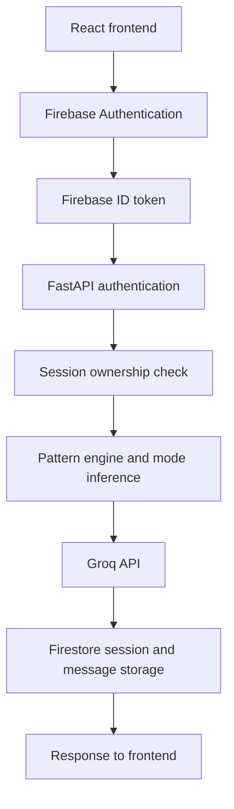

# Mitra — Backend

The FastAPI service for **Mitra**, an adaptive conversational companion. It analyses message patterns, selects a response style, generates replies with the Groq API, and stores conversation sessions and feedback in Firebase Firestore.

<div align="center">

[](https://fastapi.tiangolo.com/)
[](https://www.python.org/)
[](https://firebase.google.com/)
[](https://groq.com/)

</div>

## Overview

Mitra adapts its conversational style to the user's messages. It currently supports three response modes:

- **Friend** — warm, conversational responses.
- **Guide** — structured, actionable guidance.
- **Therapist** — reflective and empathetic response style.

These are conversational styles only. Mitra is not a licensed therapist, medical service or substitute for professional care.

## How It Works

1. The frontend signs the user in with Firebase Authentication.
2. The frontend obtains a Firebase ID token and sends it as a Bearer token.
3. FastAPI verifies the token with the Firebase Admin SDK.
4. The API checks that the requested Firestore session belongs to the authenticated Firebase UID.
5. The pattern engine analyses the message and the mode inference logic selects a response style.
6. The Groq API generates a response.
7. Session history, pattern counters, mode history and message feedback are stored in Firestore.



## Tech Stack

| Area | Technology |
|---|---|
| API framework | FastAPI |
| Language | Python |
| Authentication | Firebase Authentication + Admin SDK token verification |
| LLM provider | Groq API |
| Database | Firebase Firestore |
| Request validation | Pydantic |
| Local configuration | python-dotenv |
| Deployment configuration | Render |

## Project Structure

```text
mitra-backend/
├── main.py              # FastAPI app, authentication and API endpoints
├── firebase_config.py   # Firebase Admin and Firestore setup
├── pattern_engine.py    # Pattern detection, mode inference and prompts
├── requirements.txt     # Python dependencies
├── render.yaml          # Render service configuration
├── runtime.txt          # Python runtime version
├── .env.example         # Environment variable template
└── .gitignore
```

## Getting Started

### Prerequisites

- Python 3.12
- A Firebase project with Firestore and Authentication enabled
- A Groq API key

### 1. Clone the repository

```bash
git clone https://github.com/ManojKumarBhagavatula/mitra-backend.git
cd mitra-backend
```

### 2. Create and activate a virtual environment

**Windows (PowerShell):**

```powershell
python -m venv venv
.\venv\Scripts\Activate.ps1
```

**macOS / Linux:**

```bash
python3 -m venv venv
source venv/bin/activate
```

### 3. Install dependencies

```bash
pip install -r requirements.txt
```

### 4. Configure environment variables

Copy the example file:

```bash
cp .env.example .env
```

On Windows PowerShell:

```powershell
Copy-Item .env.example .env
```

Set the values in `.env`:

```env
GROQ_API_KEY=your-groq-api-key
GROQ_MODEL=openai/gpt-oss-20b
FIREBASE_CREDENTIALS_PATH=serviceAccountKey.json
FRONTEND_ORIGIN=http://localhost:3000
```

For multiple trusted frontend origins, separate exact origins with commas. Do not include paths or trailing slashes.

### 5. Configure Firebase

1. Open the [Firebase Console](https://console.firebase.google.com/).
2. Enable **Authentication** and the sign-in providers used by the frontend (Google and Email/Password).
3. Enable **Cloud Firestore**.
4. Open Project Settings → Service Accounts and generate a private key for the Firebase Admin SDK.
5. Save the downloaded JSON file in the backend project directory as `serviceAccountKey.json`.

The backend reads this file through `FIREBASE_CREDENTIALS_PATH`. For deployment, it can instead read the full service-account JSON from `FIREBASE_CREDENTIALS_JSON`.

**Never commit** `.env`, `serviceAccountKey.json`, service-account JSON, or private API keys to GitHub.

### 6. Run the API

```bash
uvicorn main:app --reload
```

- API: [http://localhost:8000](http://localhost:8000)
- Interactive docs: [http://localhost:8000/docs](http://localhost:8000/docs)
- Public health check: [http://localhost:8000/health](http://localhost:8000/health)

## Authentication and Session Ownership

All application endpoints except `GET /health` require:

```http
Authorization: Bearer <Firebase_ID_Token>
```

The frontend obtains this token from the currently signed-in Firebase user and sends it with chat and feedback requests. FastAPI verifies the token using Firebase Admin SDK. The authenticated token's `uid` is the identity used for session ownership.

Every new session stores an `owner_uid`. Chat continuation, profile reads and feedback writes verify that the session belongs to the authenticated user. Requests for another user's session return `404` rather than revealing that the session exists.

The original frontend used the Firebase UID as the first session document ID. To preserve that initial legacy session, the backend can claim an owner-less document only when its document ID exactly matches the authenticated UID. Other owner-less legacy sessions are not automatically claimed or exposed.

The backend uses the Firebase Admin SDK, which accesses Firestore with server privileges and is not restricted by client Firestore Security Rules. Keep the service-account key private and enforce ownership checks in the API for every user-scoped operation.

## API Reference

### `POST /chat`

Requires Firebase Bearer authentication.

**Request body**

```json
{
  "session_id": null,
  "message": "I've been feeling stressed about work lately.",
  "mode": "auto"
}
```

- `session_id`: optional session identifier; reuse the returned ID to continue the same session.
- `message`: non-empty text, up to 10,000 characters.
- `mode`: `auto`, `friend`, `guide` or `therapist`.

**Response shape**

```json
{
  "session_id": "session-id",
  "reply": "Generated response text",
  "mode_used": "friend",
  "patterns": {
    "emotional": 1,
    "venting": 0,
    "advice": 0,
    "solution": 0,
    "why": 0,
    "totalMsgs": 1
  },
  "message_id": "message-id"
}
```

### `GET /profile/{session_id}`

Requires authentication and returns the pattern profile for a session owned by the signed-in user.

### `POST /feedback`

Requires authentication and a session owned by the signed-in user.

```json
{
  "session_id": "session-id",
  "message_id": "message-id",
  "rating": 1
}
```

Use `1` for positive feedback and `-1` for negative feedback.

### `GET /health`

Public endpoint for hosting-provider health checks. It does not expose user or session data.

## Test with curl

Obtain a Firebase ID token from a signed-in Firebase user, then use it in the Authorization header:

```bash
export MITRA_ID_TOKEN="your-firebase-id-token"
```

**Send a first message:**

```bash
curl -X POST http://localhost:8000/chat \
  -H "Authorization: Bearer $MITRA_ID_TOKEN" \
  -H "Content-Type: application/json" \
  -d '{"message":"I feel overwhelmed today","mode":"auto"}'
```

Use the returned `session_id` for subsequent chat requests. Include the same Authorization header when calling `/profile/{session_id}` or `/feedback`.

## Pattern Engine

The current implementation in `pattern_engine.py` uses regular-expression rules to identify emotional language, venting, requests for advice, requests for solutions and questions about causes. The accumulated pattern counters inform the response mode.

The code also contains an optional Hugging Face text-classification path when a compatible local model and its dependencies are available. The default requirements install does not include those optional ML dependencies, so regex is the standard setup.

## Firestore Data Model

The `sessions` collection stores the session ID, authenticated `owner_uid`, pattern counters, recent conversation history, mode history and creation timestamp.

Each session has a `messages` subcollection containing the user message, generated reply, selected mode, pattern snapshot, feedback rating and timestamp.

## Deployment on Render

The repository includes a `render.yaml` service definition.

1. Push the backend repository to GitHub.
2. In [Render](https://render.com/), create a Web Service from this repository and apply `render.yaml`.
3. Confirm the environment variables:
   - `GROQ_API_KEY` — your Groq API key.
   - `FIREBASE_CREDENTIALS_JSON` — complete Firebase service-account JSON.
   - `FRONTEND_ORIGIN` — exact production frontend origin, currently configured as `https://mitra-frontend-ivory.vercel.app`.
4. Deploy and check `/health`.

The configured start command is:

```bash
uvicorn main:app --host 0.0.0.0 --port $PORT
```

For local development, set `FRONTEND_ORIGIN=http://localhost:3000`. If you use a different Vercel production domain or preview domain, add the exact origin to the Render environment variable. CORS is a browser policy and does not replace authentication.

## Security Notes

These changes add Firebase ID-token verification, per-session owner checks, exact-origin CORS configuration, request validation and generic upstream error responses. They are important safeguards, but do not by themselves constitute a complete production security review.

Before handling sensitive conversations, also consider rate limiting, abuse monitoring, data retention/deletion controls, backups, operational alerting and a privacy policy. Review Firebase Authentication settings and the security of the Google/Email sign-in configuration. Rotate any credential that has ever been committed to a public repository.

## Related Repositories

- [Mitra frontend](https://github.com/ManojKumarBhagavatula/mitra-frontend)
- [Live application](https://mitra-frontend-ivory.vercel.app/)

---

<div align="center">

**Mitra — an adaptive companion, built with FastAPI, Firestore and Groq.**

</div>
